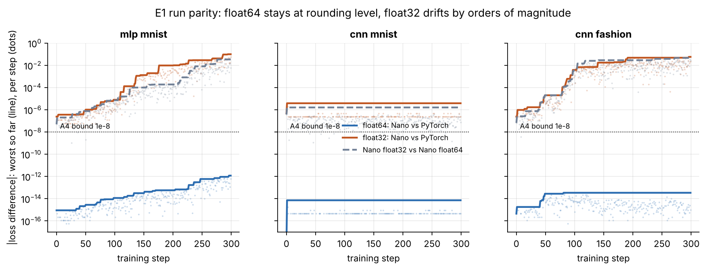

# Nano

**A neural network library in pure NumPy with a hand-written reverse-mode autodiff tape,
verified against PyTorch to machine precision, then used for one pre-registered study of
why deep networks fail to train.**

Hundreds of people have built a NumPy autograd clone. Correctness alone does not stand out,
so Nano is built around evidence a skeptic can re-run with one command:

1. **A verification ladder** with a stated, falsifiable precision contract
   ([PRECISION.md](PRECISION.md)): every op against finite differences and PyTorch, one
   training step and a 300-step run against PyTorch, all in float64; float32 drift is
   published, not hidden.
2. **A failure museum**: a bug hunt where the checker names the broken op, softmax
   overflow, dead ReLUs, the exact 2/λ_max divergence bound, finite-difference blind spots,
   and every E2 cell that failed, with its diagnosed cause.
3. **A pre-registered study (E2)** with bootstrap confidence intervals and a decision rule
   committed before the first run. The result is reported whatever it is.

**Full report: [report/REPORT.md](report/REPORT.md)** · data: [report/results.json](report/results.json)
· study plan: [docs/PREREGISTRATION_E2.md](docs/PREREGISTRATION_E2.md)

<!-- results:start -->
*(generated by `report/build.py` from `report/results.json`; do not edit by hand)*

**8 of 10 acceptance criteria pass.**

| ID | Criterion | Threshold | Measured | Result |
|---|---|---|---|---|
| A1 | Per-op gradient vs central finite difference (float64) | max relative error < 1e-7 | 1.22e-8 | PASS |
| A2 | Per-op output and gradient vs PyTorch (float64) | max relative error < 1e-10 | 5.57e-16 | PASS |
| A3 | One training step vs PyTorch, MLP and CNN (float64) | max abs diff < 1e-12 | 1.11e-16 | PASS |
| A4 | 300-step run vs PyTorch (float64) | loss diff < 1e-8 at every step | 1.18e-12 | PASS |
| A5 | SGD, momentum, Nesterov, Adam, AdamW vs torch.optim | per-step param diff < 1e-12 | 2.04e-13 | PASS |
| A6 | conv2d im2col vs naive-loop reference (forward + backward) | max abs diff < 1e-12 | 1.78e-14 | PASS |
| A7 | Bug-injection demo | checker names the injected op in 5 of 5 bugs | 5 of 5 | PASS |
| A8 | E2 study pre-registered | hypothesis, metric and threshold committed before first run; CIs on every headline number | see report | FAIL |
| A9 | Library size | under 1500 lines in nano/ | 1,110 | PASS |
| A10 | Reproduction | make repro succeeds from a clean clone and regenerates results.json | see report | FAIL |



<!-- results:end -->

## Quick start

```bash
make install        # numpy; PyTorch CPU, pytest, matplotlib are dev-only (the oracle)
make test-fast      # A1, A2, A5, A6, property and isolation tests
make repro          # everything: data, tests, E1-E6, failure gallery, results.json, report
```

```python
import numpy as np
from nano import Tensor, nn, optim, softmax_cross_entropy

model = nn.Sequential(nn.Conv2d(1, 8, 3, padding=1), nn.ReLU(), nn.MaxPool2d(2),
                      nn.Flatten(), nn.Linear(8 * 14 * 14, 10))
opt = optim.AdamW(model.parameters(), lr=1e-3)

x, y = Tensor(np.random.randn(32, 1, 28, 28)), np.random.randint(0, 10, 32)
loss = softmax_cross_entropy(model(x), y=y)
opt.zero_grad(); loss.backward(); opt.step()
```

**Adding an op is a forward and a backward:**

```python
@nano.op
def softplus(a):
    """z = log(1 + e^a); dz/da = sigmoid(a)."""
    return np.logaddexp(0.0, a), lambda g: (g / (1 + np.exp(-a)),)
```

**Debugging a gradient** names the first op whose backward disagrees with finite differences:

```python
from nano.gradcheck import layerwise_report, format_report
print(format_report(*layerwise_report(loss)))
```

## What is in the box

| Path | Contents |
|---|---|
| `nano/` | the library, pure NumPy, under 1,500 lines: tape (`tensor.py`), 23 ops (`ops.py`, `conv.py`), `nn`, `init`, `optim` (SGD, momentum, Nesterov, Adam, AdamW), `sched`, `gradcheck`, `probes` |
| `evalkit/` | shared portfolio infrastructure: bootstrap CIs, AUC, Spearman, Wilson intervals, the `results.json` schema |
| `tests/` | per-module tests against finite differences and PyTorch, property tests over random broadcast patterns, isolation and size checks |
| `experiments/` | E1 parity · E2 trainability · E3 optimizer grid · E4 bug hunt · E5 speed · E6 FD error · failure gallery |
| `report/` | `REPORT.md` (generated), `results.json`, figures, [derivations](report/derivations/DERIVATIONS.md) |
| `machine/` | the Backprop Machine: an interactive see-through picture of the tape whose pipe widths are E2's real gradient norms (`make machine`, then open `/machine/`) |
| `docs/` | pre-registration, deviations log, decision log |

## Verification ladder

| Rung | Check | Tolerance | Where |
|---|---|---|---|
| 1 | Derive on paper | — | [DERIVATIONS.md](report/derivations/DERIVATIONS.md) (each op's docstring cites its section) |
| 2 | Finite differences, float64 | rel. error < 1e-7 | `tests/test_gradcheck.py` |
| 3 | PyTorch per-op parity, float64 | rel. error < 1e-10 | `tests/test_parity_ops.py` |
| 4 | Property tests | random shapes and broadcasts | `tests/test_properties.py` |
| 5 | Step parity | abs. diff < 1e-12 | `experiments/parity.py` |
| 6 | Run parity (300 steps) | loss diff < 1e-8 | `experiments/parity.py` |
| 7 | Independent conv oracle | im2col vs naive loop < 1e-12 | `tests/test_conv.py` |
| 8 | Mutation testing | checker names 5 of 5 injected bugs | `experiments/bughunt.py` |

## Non-goals

GPU support, BatchNorm, dropout, attention, RNNs, competing with PyTorch on speed (the
slowdown is measured, not minimised), a plugin system, and any claim of algorithmic
novelty. The contribution is rigour and one honest empirical finding.

## For contributors and coding agents

Read [AGENTS.md](AGENTS.md) (invariants, commands, the recipe for adding an op).
[CLAUDE.md](CLAUDE.md) imports it for Claude Code.

## License

MIT, see [LICENSE](LICENSE).
