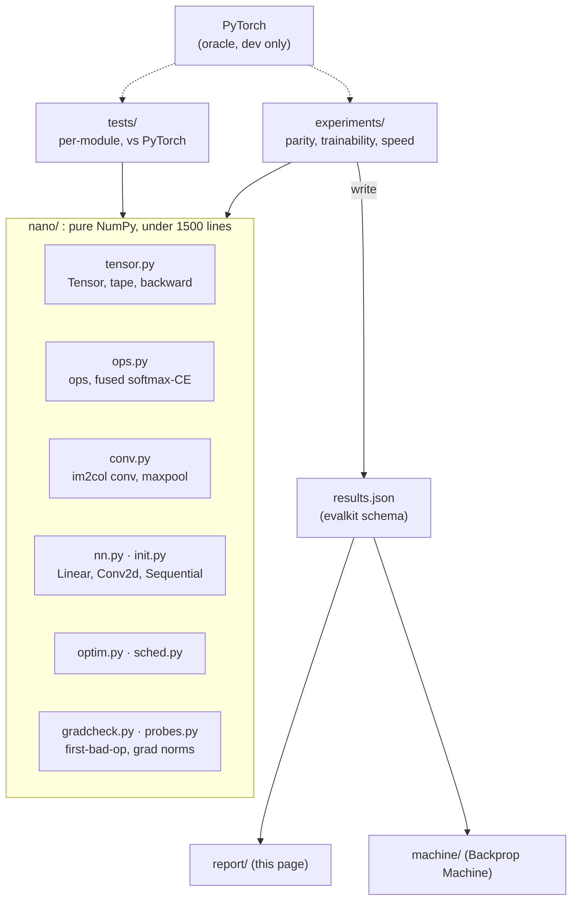

# Nano: a NumPy neural engine, verified and then broken on purpose

*Project 1A. Generated from [`results.json`](results.json) (schema 1.0, commit `fa3be54e38`,
2026-11-06T08:48:46+00:00). Hardware: Intel(R) Xeon(R) Processor @ 2.10GHz, 4 cores, 15.7 GB RAM, Linux 6.18.44-fc-v242;
Python 3.13.18, NumPy 2.5.3 (scipy-openblas 0.3.34.106.0), PyTorch 2.15.0 (oracle only).*

## Acceptance criteria

8 of 10 criteria pass in this build. Each row is checked by a script, not by hand.

| ID | Criterion | Threshold | Measured | Result | Checked by |
|---|---|---|---|---|---|
| A1 | Per-op gradient vs central finite difference (float64) | max relative error < 1e-7 | 1.22e-8 | PASS | `tests/test_gradcheck.py; E1 table` |
| A2 | Per-op output and gradient vs PyTorch (float64) | max relative error < 1e-10 | 5.57e-16 | PASS | `tests/test_parity_ops.py; E1 table` |
| A3 | One training step vs PyTorch, MLP and CNN (float64) | max abs diff < 1e-12 | 1.11e-16 | PASS | `experiments/parity.py` |
| A4 | 300-step run vs PyTorch (float64) | loss diff < 1e-8 at every step | 1.18e-12 | PASS | `experiments/parity.py` |
| A5 | SGD, momentum, Nesterov, Adam, AdamW vs torch.optim | per-step param diff < 1e-12 | 2.04e-13 | PASS | `tests/test_optim.py` |
| A6 | conv2d im2col vs naive-loop reference (forward + backward) | max abs diff < 1e-12 | 1.78e-14 | PASS | `tests/test_conv.py` |
| A7 | Bug-injection demo | checker names the injected op in 5 of 5 bugs | 5 of 5 | PASS | `experiments/bughunt.py` |
| A8 | E2 study pre-registered | hypothesis, metric and threshold committed before first run; CIs on every headline number | preregistration_commit: 914ecfa 2026-11-06T08:28:13+00:00; config_freeze_commit: 35cf082 2026-11-06T08:47:15+00:00; config_frozen: yes; headline_numbers_with_ci: no; verdict: n/a | **FAIL** | `repo history plus report` |
| A9 | Library size | under 1500 lines in nano/ | 1,110 | PASS | `make loc` |
| A10 | Reproduction | make repro succeeds from a clean clone and regenerates results.json | fragments_present: E1, E4, E6, FAILURES; ran_under_make_repro: no | **FAIL** | `CI job .github/workflows/repro.yml` |

## 1. Problem and architecture

A from-scratch autodiff engine is the most common ML portfolio project, so the default
assumption is that it is a tutorial copy. Typical clones show a loss curve going down,
which proves nothing about gradient correctness; claim "matches PyTorch" in float32 over a
long run, which is unfalsifiable; and mention vanishing gradients without measuring them.

Nano answers each weakness with evidence: a verification ladder a skeptic can re-run
(`make repro`), a precision contract stated in float64 ([PRECISION.md](../PRECISION.md)),
a failure gallery, and one pre-registered study with confidence intervals.



## 2. Parity with PyTorch: float64 against float32 (E1)

**Per step and per run.** Nano and PyTorch start from identical weights, see identical batches
and take 300 SGD-momentum steps, single-threaded. In float64 the worst one-step parameter
difference is 1.11e-16 (A3 bound 1e-12) and the worst
loss difference over the whole run is 1.18e-12 (A4 bound
1e-8). The same runs in float32 drift to 0.0982:
that is the drift a float32 "matches PyTorch" claim has to live with, shown rather than hidden.

| Setup | f64: 1-step param diff | f64: max loss diff (300 steps) | f32: 1-step param diff | f32: max loss diff | Nano f32 vs Nano f64 | test acc. after run (f64) |
|---|---|---|---|---|---|---|
| mlp mnist | 5.55e-17 | 1.18e-12 | 2.98e-8 | 0.0982 | 0.0335 | 93.6% |
| cnn mnist | 1.11e-16 | 7.11e-15 | 7.45e-8 | 3.81e-6 | 1.60e-6 | 11.3% |
| cnn fashion | 1.11e-16 | 3.36e-14 | 1.19e-7 | 0.0567 | 0.0557 | 77.7% |


**Per op.** Max relative error over 5 random draws per op, against central finite differences (A1)
and against PyTorch in both precisions (A2). Worst FD error 1.22e-8,
worst float64 PyTorch error 5.57e-16.

<details><summary>Per-op table (31 cases)</summary>

| Op case | vs FD (f64) | PyTorch output (f64) | PyTorch grad (f64) | PyTorch grad (f32) |
|---|---|---|---|---|
| `add` | 1.08e-9 | 0 | 1.92e-16 | 0 |
| `add_bcast` | 4.60e-10 | 0 | 2.18e-16 | 1.23e-7 |
| `sub` | 8.98e-10 | 0 | 0 | 0 |
| `mul` | 3.67e-10 | 0 | 0 | 0 |
| `div` | 3.74e-10 | 0 | 2.88e-16 | 7.00e-8 |
| `pow` | 1.49e-10 | 1.18e-16 | 1.74e-16 | 9.34e-8 |
| `pow_int` | 2.00e-10 | 2.00e-16 | 1.68e-16 | 7.45e-8 |
| `neg` | 8.98e-10 | 0 | 0 | 0 |
| `exp` | 2.76e-10 | 0 | 0 | 6.85e-8 |
| `log` | 1.42e-10 | 0 | 0 | 0 |
| `relu` | 4.17e-10 | 0 | 0 | 0 |
| `tanh` | 2.23e-9 | 1.29e-16 | 9.63e-17 | 6.66e-8 |
| `sigmoid` | 3.63e-9 | 1.56e-16 | 2.45e-16 | 1.64e-7 |
| `matmul` | 3.31e-10 | 0 | 0 | 6.96e-8 |
| `matmul_batched` | 5.51e-10 | 0 | 2.13e-16 | 1.14e-7 |
| `reshape` | 8.98e-10 | 0 | 0 | 0 |
| `transpose` | 3.62e-10 | 0 | 0 | 0 |
| `transpose_T` | 1.81e-10 | 0 | 0 | 0 |
| `getitem` | 2.71e-10 | 0 | 0 | 0 |
| `sum` | 7.29e-10 | 0 | 0 | 0 |
| `sum_all` | 2.52e-10 | 5.57e-16 | 0 | 0 |
| `mean` | 3.10e-10 | 0 | 0 | 0 |
| `max` | 1.64e-10 | 0 | 0 | 0 |
| `max_all` | 9.35e-11 | 0 | 0 | 0 |
| `logsumexp` | 7.13e-10 | 2.08e-16 | 4.64e-16 | 3.01e-7 |
| `softmax_cross_entropy` | 2.19e-9 | 1.65e-16 | 2.04e-16 | 1.09e-7 |
| `conv2d` | 2.85e-9 | 0 | 3.49e-16 | 2.28e-7 |
| `conv2d_s1` | 1.48e-9 | 0 | 4.48e-16 | 2.94e-7 |
| `conv2d_naive` | 1.52e-9 | 3.04e-16 | 4.75e-16 | 2.58e-7 |
| `maxpool2d` | 1.22e-8 | 0 | 0 | 0 |
| `maxpool2d_overlap` | 3.16e-9 | 0 | 2.01e-16 | 1.08e-7 |

</details>


## 3. Gradcheck coverage, the bug hunt and the FD error curve (E4, E6)

Every registered op has a finite-difference case and a PyTorch case
(`experiments/op_cases.py`; a test fails if an op is added without one). The table in
section 2 lists each op's max error.

**Bug hunt (A7).** Five silent bugs are injected one at a time. Each keeps every shape
correct, so the model still trains. A whole-model gradcheck notices *that* something is
wrong (large relative error) but not *where*. The layerwise checker re-runs every tape node's
op in isolation against finite differences, in forward order, and names the first one that
disagrees. Result: **5.00 of 5 located**; the bug-free control passes
every op.

| Bug | Injected defect | Expected | Checker names | Whole-model rel. err | Located |
|---|---|---|---|---|---|
| control | no bug injected | — | none (all ops pass) | 3.58e-9 | yes |
| B1 | wrong broadcast sum in add (mean instead of sum) | `add` | `add` | 0.75 | yes |
| B2 | missing transpose in transpose backward (reshape) | `transpose` | `transpose` | 1.54 | yes |
| B3 | off-by-one in col2im | `conv2d` | `conv2d` | 1.46 | yes |
| B4 | tanh derivative 1 - y instead of 1 - y^2 | `tanh` | `tanh` | 0.987 | yes |
| B5 | cross entropy backward missing 1/N | `softmax_cross_entropy` | `softmax_cross_entropy` | 0.75 | yes |
| B3-shared | off-by-one in the shared col2im helper | `maxpool2d` | `maxpool2d` | 1.67 | yes |

<details><summary>Checker output for B3 (off-by-one in col2im)</summary>

```
  #  op                    layer                       shape                rel err  status
  0  conv2d                Sequential/0:Conv2d         (4, 4, 28, 28)      4.72e-10  ok
  1  relu                  Sequential/1:ReLU           (4, 4, 28, 28)      3.45e-09  ok
  2  maxpool2d             Sequential/2:MaxPool2d      (4, 4, 14, 14)      2.45e-09  ok
  3  conv2d                Sequential/3:Conv2d         (4, 8, 14, 14)      1.56e+00  FAIL <- first bad op
  4  relu                  Sequential/4:ReLU           (4, 8, 14, 14)      4.35e-09  ok
  5  maxpool2d             Sequential/5:MaxPool2d      (4, 8, 7, 7)        2.62e-09  ok
  6  reshape               Sequential/6:Flatten        (4, 392)            2.35e-09  ok
  7  transpose             Sequential/7:Linear         (392, 32)           1.57e-10  ok
  8  matmul                Sequential/7:Linear         (4, 32)             3.74e-09  ok
  9  add                   Sequential/7:Linear         (4, 32)             1.57e-09  ok
 10  tanh                  Sequential/8:Tanh           (4, 32)             6.76e-10  ok
 11  transpose             Sequential/9:Linear         (32, 10)            8.39e-11  ok
 12  matmul                Sequential/9:Linear         (4, 10)             3.45e-10  ok
 13  add                   Sequential/9:Linear         (4, 10)             3.37e-10  ok
 14  softmax_cross_entropy                             ()                  1.35e-09  ok
first bad op: conv2d in Sequential/3:Conv2d
```
</details>

**Finite-difference error vs step size (E6).** Central differences trade truncation error
(∝ h²) against rounding error (∝ ε/h), giving a U-curve with its minimum near
h* = (3ε)^(1/3) (derivation D11). Measured best h, geometric mean over ops:
1.15e-4 in float64 (theory 8.73e-6)
and 0.0205 in float32 (theory 0.0071).
At the gradcheck step h = 1e-6 the worst op error is 1.17e-9, inside the A1
bound of 1e-7. Linear ops (matmul, conv) have no truncation term, so their curves only rise.
In float32 no step size certifies a gradient to better than about 1e-5, which is why the
contract is stated in float64.


## 4. E2 trainability study

Not run in this build.


## 6. Derivations

Every backward rule is derived in [derivations/DERIVATIONS.md](derivations/DERIVATIONS.md); each op's
docstring carries its tag (e.g. `[D8.3]` for conv2d) and a test enforces that every op has one.
Handwritten scans go in [derivations/scans/](derivations/scans/).

## 7. Design trade-offs considered and rejected

See [docs/DECISIONS.md](../docs/DECISIONS.md): dynamic tape over a static graph, im2col with a
naive-loop oracle over direct or FFT convolution, fused max-shifted cross entropy over the
composed one, one central `unbroadcast` over per-op handling, float64 verification over
float32, an `@op` decorator over a class per op, PyTorch as an isolated oracle over a
reimplemented reference.

## 8. Failure gallery

Every way the engine and the networks go wrong, measured.

**F1. float32 drift against float64 parity.** Section 2: float64 parity holds at rounding level for
the whole run while float32 drifts by orders of magnitude.

**F2. Softmax overflow without max subtraction.** The composed softmax → log → NLL produces
inf/NaN once the largest logit reaches 73.52 in float32 and
584.02 in float64 (e^z overflows near 88.7 and 709.8).
The fused, max-shifted version stays finite at every scale tested (derivation D7.2).


**F3. Dead ReLUs at high learning rate.** A 4 × 128 ReLU MLP (He init), plain SGD, 400 steps.
Fraction of units dead on 512 training images (worst layer), mean of 3 seeds [bootstrap CI]:

| Learning rate | Dead fraction at end |
|---|---|
| 0.01 | 0.05208 [0.03906, 0.0625] |
| 0.1 | 0.01562 [0.01562, 0.01562] |
| 0.5 | 0.8828 [0.8281, 0.9531] |
| 1 | 0.9062 [0.8828, 0.9453] |


**F4. SGD divergence past the stable learning rate.** For least squares with Hessian H, gradient
descent converges iff lr < 2/λ_max (derivation D10.5). Here λ_max = 10.670, so the bound is
0.18744; the empirical edge found by bisection is 0.18759, a relative gap of
7.84e-4.


**F5. Finite differences at ReLU kinks and max-pool ties.** Within h of a kink or tie the
central difference measures an average of two one-sided slopes and the check fails, though the
code is correct. This is why gradcheck samples away from kinks (PRECISION.md, blind spots).


**F6. Every failing cell in E2**, with its diagnosed cause: section 4.


## 10. Reproduce everything

```bash
git clone <this repo> && cd NANO
make install
make repro          # data -> tests -> E1..E6 + failures -> results.json -> this report
```

Measured compute in this build: 1.1 CPU-hours summed over experiments (E2 dominates;
it runs on all cores, so wall time is roughly that divided by the core count). `make repro QUICK=1`
runs the whole pipeline at reduced size in minutes (its numbers are not the published ones).
Datasets are pinned by SHA-256, seeds are fixed in `experiments/seeds.json`, and versions of
Python, NumPy, BLAS and PyTorch are recorded in every results fragment.
