# Nano: a NumPy neural engine, verified and then broken on purpose

*Project 1A. Generated from [`results.json`](results.json) (schema 1.0, commit `e021997a98`,
2026-11-06T10:09:59+00:00). Hardware: Intel(R) Xeon(R) Processor @ 2.10GHz, 4 cores, 15.7 GB RAM, Linux 6.18.44-fc-v242;
Python 3.13.18, NumPy 2.5.3 (scipy-openblas 0.3.34.106.0), PyTorch 2.15.0 (oracle only).*

## Acceptance criteria

9 of 10 criteria pass in this build. Each row is checked by a script, not by hand.

| ID | Criterion | Threshold | Measured | Result | Checked by |
|---|---|---|---|---|---|
| A1 | Per-op gradient vs central finite difference (float64) | max relative error < 1e-7 | 1.22e-8 | PASS | `tests/test_gradcheck.py; E1 table` |
| A2 | Per-op output and gradient vs PyTorch (float64) | max relative error < 1e-10 | 5.57e-16 | PASS | `tests/test_parity_ops.py; E1 table` |
| A3 | One training step vs PyTorch, MLP and CNN (float64) | max abs diff < 1e-12 | 1.11e-16 | PASS | `experiments/parity.py` |
| A4 | 300-step run vs PyTorch (float64) | loss diff < 1e-8 at every step | 1.18e-12 | PASS | `experiments/parity.py` |
| A5 | SGD, momentum, Nesterov, Adam, AdamW vs torch.optim | per-step param diff < 1e-12 | 2.04e-13 | PASS | `tests/test_optim.py` |
| A6 | conv2d im2col vs naive-loop reference (forward + backward) | max abs diff < 1e-12 | 1.78e-14 | PASS | `tests/test_conv.py` |
| A7 | Bug-injection demo | checker names the injected op in 5 of 5 bugs | 5 of 5 | PASS | `experiments/bughunt.py` |
| A8 | E2 study pre-registered | hypothesis, metric and threshold committed before first run; CIs on every headline number | preregistration_commit: 914ecfa 2026-11-06T08:28:13+00:00; config_freeze_commit: 35cf082 2026-11-06T08:47:15+00:00; config_frozen: yes; headline_numbers_with_ci: yes; verdict: partially confirmed | PASS | `repo history plus report` |
| A9 | Library size | under 1500 lines in nano/ | 1,110 | PASS | `make loc` |
| A10 | Reproduction | make repro succeeds from a clean clone and regenerates results.json | fragments_present: E1, E2, E3, E4, E5, E6, FAILURES; ran_under_make_repro: yes; from_clean_clone: no | pending (CI) | `CI job .github/workflows/repro.yml` |

## 1. Problem and architecture

A from-scratch autodiff engine is the most common ML portfolio project, so the default
assumption is that it is a tutorial copy. Typical clones show a loss curve going down,
which proves nothing about gradient correctness; claim "matches PyTorch" in float32 over a
long run, which is unfalsifiable; and mention vanishing gradients without measuring them.

Nano answers each weakness with evidence: a verification ladder a skeptic can re-run
(`make repro`), a precision contract stated in float64 ([PRECISION.md](../PRECISION.md)),
a failure gallery, and one pre-registered study with confidence intervals.

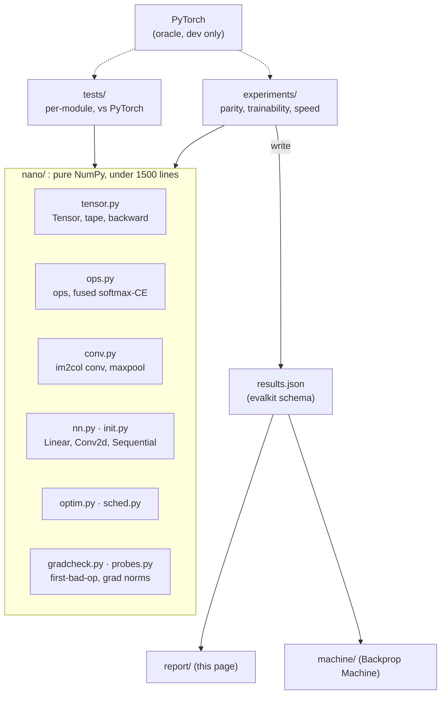

## 2. Parity with PyTorch: float64 against float32 (E1)

**Per step and per run.** Nano and PyTorch start from identical weights, see identical batches
and take 300 SGD-momentum steps, single-threaded. In float64 the worst one-step parameter
difference is 1.11e-16 (A3 bound 1e-12) and the worst
loss difference over the whole run is 1.18e-12 (A4 bound
1e-8). The same runs in float32 drift to 0.0982:
that is the drift a float32 "matches PyTorch" claim has to live with, shown rather than hidden.

| Setup | f64: 1-step param diff | f64: max loss diff (300 steps) | f32: 1-step param diff | f32: max loss diff | Nano f32 vs Nano f64 | test acc. after run (f64) |
|---|---|---|---|---|---|---|
| mlp mnist | 5.55e-17 | 1.18e-12 | 2.98e-8 | 0.0982 | 0.0335 | 93.6% |
| cnn mnist | 1.11e-16 | 7.11e-15 | 7.45e-8 | 3.81e-6 | 1.60e-6 | 11.3% |
| cnn fashion | 1.11e-16 | 3.36e-14 | 1.19e-7 | 0.0567 | 0.0557 | 77.7% |

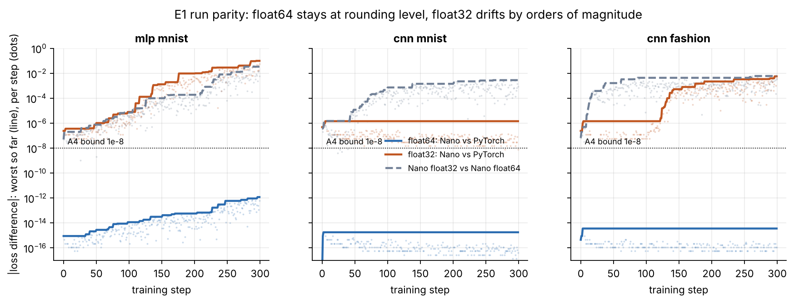

**Per op.** Max relative error over 5 random draws per op, against central finite differences (A1)
and against PyTorch in both precisions (A2). Worst FD error 1.22e-8,
worst float64 PyTorch error 5.57e-16.

<details><summary>Per-op table (31 cases)</summary>

| Op case | vs FD (f64) | PyTorch output (f64) | PyTorch grad (f64) | PyTorch grad (f32) |
|---|---|---|---|---|
| `add` | 1.08e-9 | 0 | 1.92e-16 | 0 |
| `add_bcast` | 4.60e-10 | 0 | 2.18e-16 | 1.23e-7 |
| `sub` | 8.98e-10 | 0 | 0 | 0 |
| `mul` | 3.67e-10 | 0 | 0 | 0 |
| `div` | 3.74e-10 | 0 | 2.88e-16 | 7.00e-8 |
| `pow` | 1.49e-10 | 1.18e-16 | 1.74e-16 | 9.34e-8 |
| `pow_int` | 2.00e-10 | 2.00e-16 | 1.68e-16 | 7.45e-8 |
| `neg` | 8.98e-10 | 0 | 0 | 0 |
| `exp` | 2.76e-10 | 0 | 0 | 6.85e-8 |
| `log` | 1.42e-10 | 0 | 0 | 0 |
| `relu` | 4.17e-10 | 0 | 0 | 0 |
| `tanh` | 2.23e-9 | 1.29e-16 | 9.63e-17 | 6.66e-8 |
| `sigmoid` | 3.63e-9 | 1.56e-16 | 2.45e-16 | 1.64e-7 |
| `matmul` | 3.31e-10 | 0 | 0 | 6.96e-8 |
| `matmul_batched` | 5.51e-10 | 0 | 2.13e-16 | 1.14e-7 |
| `reshape` | 8.98e-10 | 0 | 0 | 0 |
| `transpose` | 3.62e-10 | 0 | 0 | 0 |
| `transpose_T` | 1.81e-10 | 0 | 0 | 0 |
| `getitem` | 2.71e-10 | 0 | 0 | 0 |
| `sum` | 7.29e-10 | 0 | 0 | 0 |
| `sum_all` | 2.52e-10 | 5.57e-16 | 0 | 0 |
| `mean` | 3.10e-10 | 0 | 0 | 0 |
| `max` | 1.64e-10 | 0 | 0 | 0 |
| `max_all` | 9.35e-11 | 0 | 0 | 0 |
| `logsumexp` | 7.13e-10 | 2.08e-16 | 4.64e-16 | 3.01e-7 |
| `softmax_cross_entropy` | 2.19e-9 | 1.65e-16 | 2.04e-16 | 1.09e-7 |
| `conv2d` | 2.85e-9 | 0 | 3.49e-16 | 2.28e-7 |
| `conv2d_s1` | 1.48e-9 | 0 | 4.48e-16 | 2.94e-7 |
| `conv2d_naive` | 1.52e-9 | 3.04e-16 | 4.75e-16 | 2.58e-7 |
| `maxpool2d` | 1.22e-8 | 0 | 0 | 0 |
| `maxpool2d_overlap` | 3.16e-9 | 0 | 2.01e-16 | 1.08e-7 |

</details>

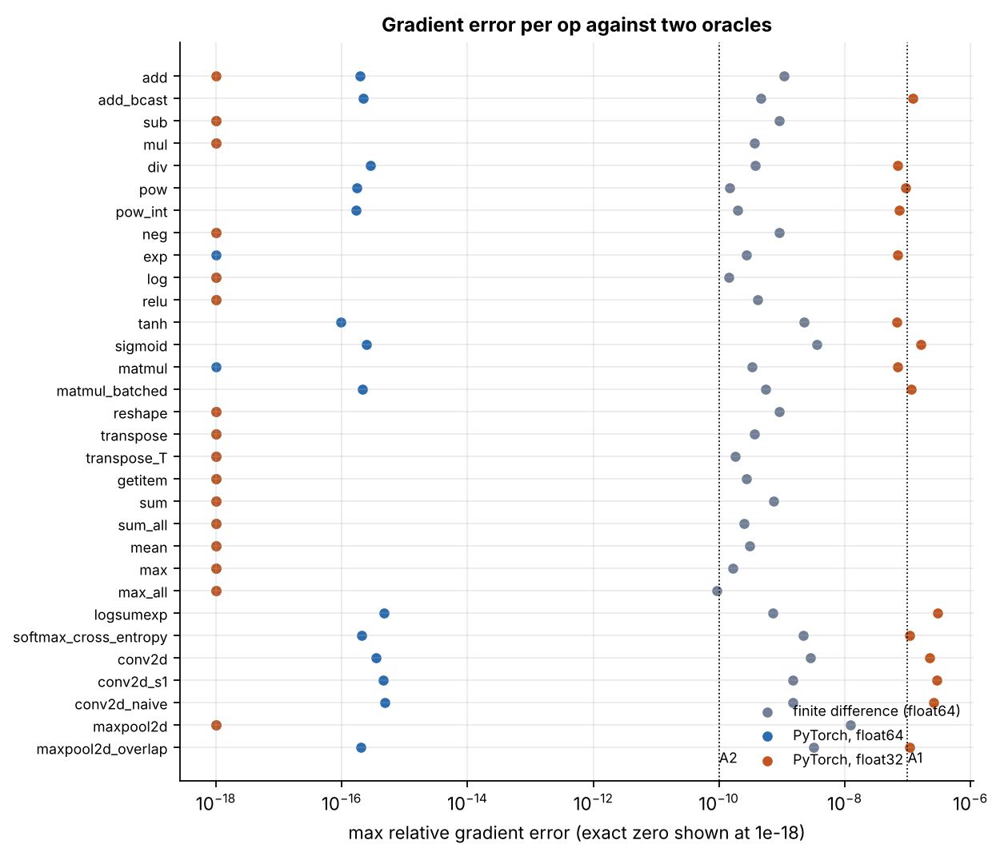

## 3. Gradcheck coverage, the bug hunt and the FD error curve (E4, E6)

Every registered op has a finite-difference case and a PyTorch case
(`experiments/op_cases.py`; a test fails if an op is added without one). The table in
section 2 lists each op's max error.

**Bug hunt (A7).** Five silent bugs are injected one at a time. Each keeps every shape
correct, so the model still trains. A whole-model gradcheck notices *that* something is
wrong (large relative error) but not *where*. The layerwise checker re-runs every tape node's
op in isolation against finite differences, in forward order, and names the first one that
disagrees. Result: **5.00 of 5 located**; the bug-free control passes
every op.

| Bug | Injected defect | Expected | Checker names | Whole-model rel. err | Located |
|---|---|---|---|---|---|
| control | no bug injected | — | none (all ops pass) | 3.58e-9 | yes |
| B1 | wrong broadcast sum in add (mean instead of sum) | `add` | `add` | 0.75 | yes |
| B2 | missing transpose in transpose backward (reshape) | `transpose` | `transpose` | 1.54 | yes |
| B3 | off-by-one in col2im | `conv2d` | `conv2d` | 1.46 | yes |
| B4 | tanh derivative 1 - y instead of 1 - y^2 | `tanh` | `tanh` | 0.987 | yes |
| B5 | cross entropy backward missing 1/N | `softmax_cross_entropy` | `softmax_cross_entropy` | 0.75 | yes |
| B3-shared | off-by-one in the shared col2im helper | `maxpool2d` | `maxpool2d` | 1.67 | yes |

<details><summary>Checker output for B3 (off-by-one in col2im)</summary>

```
  #  op                    layer                       shape                rel err  status
  0  conv2d                Sequential/0:Conv2d         (4, 4, 28, 28)      4.72e-10  ok
  1  relu                  Sequential/1:ReLU           (4, 4, 28, 28)      3.45e-09  ok
  2  maxpool2d             Sequential/2:MaxPool2d      (4, 4, 14, 14)      2.45e-09  ok
  3  conv2d                Sequential/3:Conv2d         (4, 8, 14, 14)      1.56e+00  FAIL <- first bad op
  4  relu                  Sequential/4:ReLU           (4, 8, 14, 14)      4.35e-09  ok
  5  maxpool2d             Sequential/5:MaxPool2d      (4, 8, 7, 7)        2.62e-09  ok
  6  reshape               Sequential/6:Flatten        (4, 392)            2.35e-09  ok
  7  transpose             Sequential/7:Linear         (392, 32)           1.57e-10  ok
  8  matmul                Sequential/7:Linear         (4, 32)             3.74e-09  ok
  9  add                   Sequential/7:Linear         (4, 32)             1.57e-09  ok
 10  tanh                  Sequential/8:Tanh           (4, 32)             6.76e-10  ok
 11  transpose             Sequential/9:Linear         (32, 10)            8.39e-11  ok
 12  matmul                Sequential/9:Linear         (4, 10)             3.45e-10  ok
 13  add                   Sequential/9:Linear         (4, 10)             3.37e-10  ok
 14  softmax_cross_entropy                             ()                  1.35e-09  ok
first bad op: conv2d in Sequential/3:Conv2d
```
</details>

**Finite-difference error vs step size (E6).** Central differences trade truncation error
(∝ h²) against rounding error (∝ ε/h), giving a U-curve with its minimum near
h* = (3ε)^(1/3) (derivation D11). Measured best h, geometric mean over ops:
1.15e-4 in float64 (theory 8.73e-6)
and 0.0205 in float32 (theory 0.0071).
At the gradcheck step h = 1e-6 the worst op error is 1.17e-9, inside the A1
bound of 1e-7. Linear ops (matmul, conv) have no truncation term, so their curves only rise.
In float32 no step size certifies a gradient to better than about 1e-5, which is why the
contract is stated in float64.

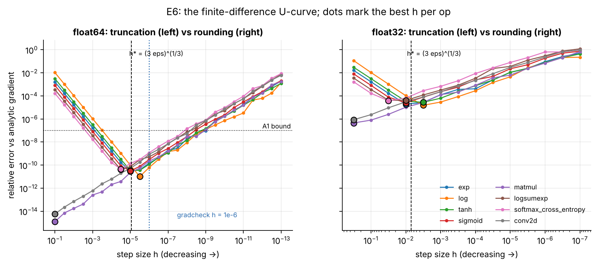

## 4. E2: trainability, pre-registered

**Question.** At what depth does each (activation, init) pair stop training, and does the
step-0 gradient-norm ratio r = log10(‖∂L/∂W_first‖ / ‖∂L/∂W_last‖) predict that failure?

The design, the definition of "trains", the predictor, hypothesis H1, the analysis plan
and the decision rule were committed in [the pre-registration](../docs/PREREGISTRATION_E2.md)
before the first run; the step budget (1500 steps) and LR grid (0.003, 0.01, 0.03,
SGD momentum 0.9) were fixed after a pilot on a non-study seed and committed before the sweep.
Deviations are logged in [DEVIATIONS.md](../docs/DEVIATIONS.md). 810 runs
(6 depths × 3 activations × 3 inits × 5 seeds × 3 learning rates),
5.1 CPU-hours.

### Result: H1 is **PARTIALLY CONFIRMED**

| Pre-registered statistic | Estimate [95% CI] |
|---|---|
| AUC of \|r\| for predicting failure (all 270 runs) | 0.6431 [0.5631, 0.7207] |
| Spearman(\|r\|, final loss) | 0.4844 [0.3681, 0.585] |
| Threshold τ fitted on seeds 0-2 | 2.779 |
| Held-out accuracy of "fail iff \|r\| > τ" (seeds 3-4, n = 108) | 0.787 [0.7037, 0.8611] |
| Held-out balanced accuracy (seeds 3-4) | 0.7653 [0.6951, 0.8364] |
| Fraction of (cell, seed) runs that train | 0.563 [0.5033, 0.6208] |
| *Exploratory X1:* AUC of −log10 ‖∂L/∂W_first‖ | 0.9633 [0.9308, 0.99] |
| *Exploratory X2:* AUC of forward attenuation \|log10(std h_D / std h_1)\| | 0.7362 [0.6745, 0.7914] |

Decision rule: confirmed if the AUC CI lower bound is ≥ 0.75 and held-out balanced accuracy
≥ 0.80; partially confirmed if the AUC CI lower bound is > 0.5; null otherwise.

**What this means.** The step-0 ratio r is a good detector of one failure mode and blind to another, and the phase diagram shows both.

* **Where r works: gradients that decay *across* the network.** Every sigmoid failure has strongly negative r, falling linearly with depth exactly as derivation D12 predicts (σ' ≤ 1/4 makes the per-layer gain smaller than one whatever the init). The fitted rule catches all of them, which is why the held-out balanced accuracy is 0.7653 [0.6951, 0.8364].
* **Where r fails: gradients that are uniformly tiny.** Small-init tanh and ReLU networks fail from depth 8 on, and ReLU with Xavier fails at depth 64, yet their r stays near 0. The gradient-norm figure shows why: their per-layer norms are *flat but shifted down* by many orders of magnitude. The forward signal collapses (gain n·σ² ≪ 1 for small init; 1/√2 per layer for ReLU with Xavier, D9.3), so the first and last layers starve together and their ratio is unremarkable. A ratio cannot see a failure that affects numerator and denominator alike: the same factor g^D shrinks the input layer's gradient and the output layer's input, and cancels (post-hoc note under derivation D12). This is why the AUC, 0.6431 [0.5631, 0.7207], clears 0.5 but not the pre-registered 0.75 bar.
* **Exploratory, not confirmatory:** the absolute first-layer gradient norm (X1, registered after the pilot and before the sweep) separates training from non-training runs with AUC 0.9633 [0.9308, 0.99], and forward attenuation (X2) reaches 0.7362 [0.6745, 0.7914]. X1 deserves its own pre-registered test on a new architecture or dataset before anyone relies on it.
* **Initialisation matched to the activation is what buys depth.** Tanh with Xavier or He trains at every depth tested, and ReLU with He to depth 32. Sigmoid stops at depth 4 regardless of init; small init stops every activation by depth 8.
* **Caveats.** One width (128), one dataset (an MNIST subset), plain SGD with momentum, and a fixed 1,500-step budget. "Fails" means "fails within this budget at the best of three learning rates". The diagnosis labels follow the pre-registered precedence: "dead ReLUs" describes the end state of small-init ReLU nets, which may be a consequence of the collapse rather than its cause.

### Phase diagram

Fraction of the 5 seeds that train (best of 3 learning rates per seed), by depth.

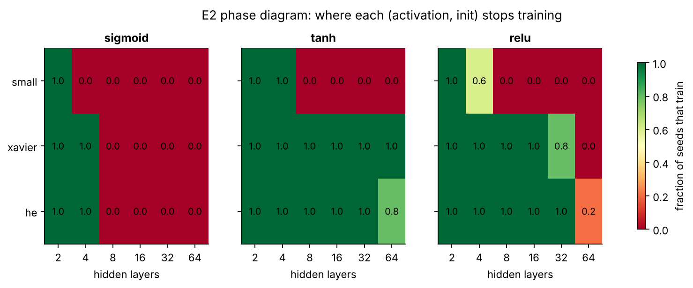

| Activation | Init | Deepest depth that trains (≥ 3/5) | First depth that fails | Seeds trained at depths 2·4·8·16·32·64 | mean r at depths 2…64 |
|---|---|---|---|---|---|
| sigmoid | small | 2 | 4 | 5/5 · 0/5 · 0/5 · 0/5 · 0/5 · 0/5 | -2.1 · -5.2 · -11.4 · -23.8 · -48.6 · -98.2 |
| sigmoid | xavier | 4 | 8 | 5/5 · 5/5 · 0/5 · 0/5 · 0/5 · 0/5 | -0.6 · -1.8 · -4.4 · -9.4 · -19.4 · -39.6 |
| sigmoid | he | 4 | 8 | 5/5 · 5/5 · 0/5 · 0/5 · 0/5 · 0/5 | -0.5 · -1.5 · -3.5 · -7.5 · -15.4 · -31.5 |
| tanh | small | 4 | 8 | 5/5 · 5/5 · 0/5 · 0/5 · 0/5 · 0/5 | 0.0 · 0.0 · -0.0 · 0.0 · -0.0 · 0.0 |
| tanh | xavier | 64 | never (≤ 64) | 5/5 · 5/5 · 5/5 · 5/5 · 5/5 · 5/5 | 0.5 · 0.5 · 0.4 · 0.5 · 0.5 · 0.5 |
| tanh | he | 64 | never (≤ 64) | 5/5 · 5/5 · 5/5 · 5/5 · 5/5 · 4/5 | 0.5 · 0.5 · 0.5 · 0.7 · 1.0 · 1.8 |
| relu | small | 4 | 8 | 5/5 · 3/5 · 0/5 · 0/5 · 0/5 · 0/5 | 0.0 · 0.1 · 0.1 · 0.1 · 0.1 · 0.2 |
| relu | xavier | 32 | 64 | 5/5 · 5/5 · 5/5 · 5/5 · 4/5 · 0/5 | 0.3 · 0.4 · 0.5 · 0.5 · 0.5 · 0.6 |
| relu | he | 32 | 64 | 5/5 · 5/5 · 5/5 · 5/5 · 5/5 · 1/5 | 0.3 · 0.2 · 0.1 · 0.1 · 0.0 · 0.1 |

### Gradient norms at initialisation and the predictor

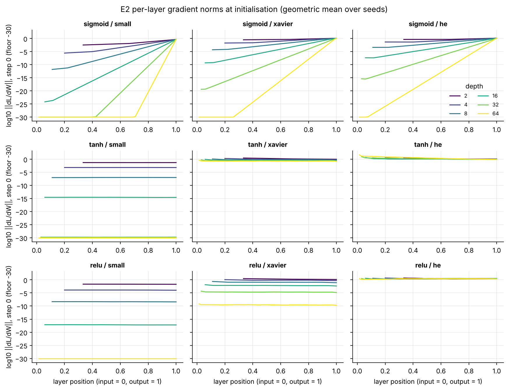

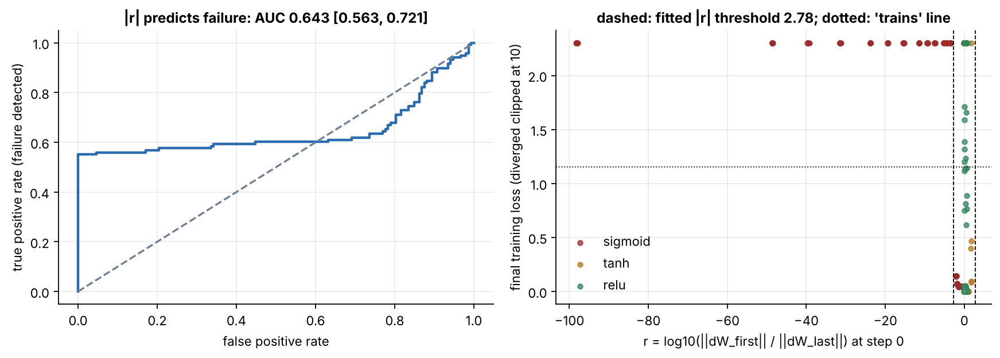

### Every failing cell, with its diagnosed cause (failure gallery F6)

Failing runs are labelled with the pre-registered precedence: overflow → dead ReLUs →
saturation → vanishing gradient (r < −2) → exploding gradient (r > 2) → slow/unexplained.
Totals over failing runs: vanishing gradient: 65, dead ReLUs: 30, slow / unexplained: 23.

| Cell | Failed seeds | Diagnosed cause (runs) | mean r | median final loss |
|---|---|---|---|---|
| relu / he / depth 64 | 4/5 | dead ReLUs (4) | 0.15 | 1.32 |
| relu / small / depth 4 | 2/5 | slow / unexplained (2) | 0.0813 | 1.14 |
| relu / small / depth 8 | 5/5 | dead ReLUs (5) | 0.0858 | 2.30 |
| relu / small / depth 16 | 5/5 | dead ReLUs (5) | 0.0896 | 2.30 |
| relu / small / depth 32 | 5/5 | dead ReLUs (5) | 0.113 | 2.30 |
| relu / small / depth 64 | 5/5 | dead ReLUs (5) | 0.164 | 2.30 |
| relu / xavier / depth 32 | 1/5 | dead ReLUs (1) | 0.523 | 0.886 |
| relu / xavier / depth 64 | 5/5 | dead ReLUs (5) | 0.574 | 2.30 |
| sigmoid / he / depth 8 | 5/5 | vanishing gradient (5) | -3.50 | 2.30 |
| sigmoid / he / depth 16 | 5/5 | vanishing gradient (5) | -7.48 | 2.30 |
| sigmoid / he / depth 32 | 5/5 | vanishing gradient (5) | -15.41 | 2.30 |
| sigmoid / he / depth 64 | 5/5 | vanishing gradient (5) | -31.47 | 2.30 |
| sigmoid / small / depth 4 | 5/5 | vanishing gradient (5) | -5.15 | 2.30 |
| sigmoid / small / depth 8 | 5/5 | vanishing gradient (5) | -11.42 | 2.30 |
| sigmoid / small / depth 16 | 5/5 | vanishing gradient (5) | -23.79 | 2.30 |
| sigmoid / small / depth 32 | 5/5 | vanishing gradient (5) | -48.61 | 2.30 |
| sigmoid / small / depth 64 | 5/5 | vanishing gradient (5) | -98.16 | 2.30 |
| sigmoid / xavier / depth 8 | 5/5 | vanishing gradient (5) | -4.39 | 2.30 |
| sigmoid / xavier / depth 16 | 5/5 | vanishing gradient (5) | -9.39 | 2.30 |
| sigmoid / xavier / depth 32 | 5/5 | vanishing gradient (5) | -19.39 | 2.30 |
| sigmoid / xavier / depth 64 | 5/5 | vanishing gradient (5) | -39.57 | 2.30 |
| tanh / he / depth 64 | 1/5 | slow / unexplained (1) | 1.76 | 0.402 |
| tanh / small / depth 8 | 5/5 | slow / unexplained (5) | -0.0257 | 2.30 |
| tanh / small / depth 16 | 5/5 | slow / unexplained (5) | 0.0285 | 2.30 |
| tanh / small / depth 32 | 5/5 | slow / unexplained (5) | -0.0227 | 2.30 |
| tanh / small / depth 64 | 5/5 | slow / unexplained (5) | 0.0266 | 2.30 |

## 5. Optimizers, inits and schedules (E3)

784-128-128-10 ReLU MLP on 10,000 MNIST images, 1000 steps of batch 128, 5 seeds per
configuration, test accuracy on 2,000 held-out images. Each optimizer uses one
standard learning rate fixed in advance (SGD 0.1; momentum/Nesterov 0.01 with μ = 0.9; Adam/AdamW 1e-3).
Only differences whose paired 95% CIs (run-level and seed-clustered) both exclude zero are claimed.

**What actually mattered.** small vs he (init): -2.05 points; warmup_cosine vs constant (schedule): -0.91 points; cosine vs constant (schedule): -0.902 points; adamw vs sgd (optimizer): 0.811 points; adam vs sgd (optimizer): 0.791 points; momentum vs sgd (optimizer): -0.257 points; nesterov vs sgd (optimizer): -0.256 points.

**Reading E3.** The ranking is dominated by initialisation: small init costs the most and interacts with the schedule. With small init the network starts slowly, and a cosine schedule lowers the learning rate before it has recovered, so the cosine penalty is concentrated in the small-init bars. Adam and AdamW beat SGD at this budget; momentum and Nesterov at learning rate 0.01 (effective step 0.1) slightly trail plain SGD at 0.1. Xavier and He are not separated once seeds are treated as the unit of replication. All of this is specific to a short 1,000-step budget and one fixed learning rate per optimizer.

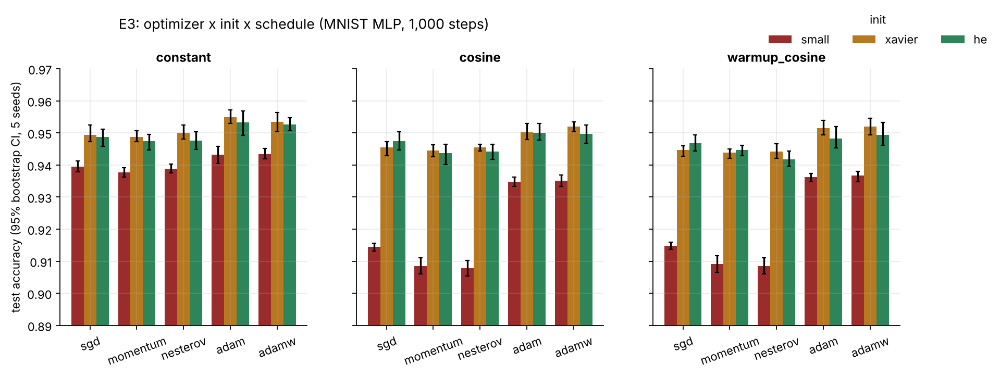

Paired contrasts (each run paired with the reference-level run that shares its seed and every other factor):

| Factor | Contrast | Δ test acc. [95% CI, run pairs] | [95% CI, seed-clustered] | sign-flip p (5 seeds) | Separated |
|---|---|---|---|---|---|
| optimizer | momentum − sgd | -0.0025667 [-0.0034111, -0.0016778] | -0.0025667 [-0.0034889, -0.0015556] | 0.0625 | **yes** |
| optimizer | nesterov − sgd | -0.0025556 [-0.0036111, -0.0014556] | -0.0025556 [-0.0038111, -0.0013] | 0.0625 | **yes** |
| optimizer | adam − sgd | 0.0079111 [0.0056222, 0.010278] | 0.0079111 [0.0060111, 0.0098222] | 0.0625 | **yes** |
| optimizer | adamw − sgd | 0.0081111 [0.0058, 0.010522] | 0.0081111 [0.0063333, 0.0098333] | 0.0625 | **yes** |
| init | small − he | -0.020473 [-0.023247, -0.017767] | -0.020473 [-0.022153, -0.018713] | 0.0625 | **yes** |
| init | xavier − he | 0.0010133 [2.6000e-4, 0.0017333] | 0.0010133 [-2.6667e-4, 0.0024133] | 0.5 | no |
| schedule | cosine − constant | -0.00902 [-0.011427, -0.00682] | -0.00902 [-0.0094533, -0.0085867] | 0.0625 | **yes** |
| schedule | warmup_cosine − constant | -0.0091 [-0.01144, -0.0069533] | -0.0091 [-0.00962, -0.0085667] | 0.0625 | **yes** |

A contrast is claimed only when both CIs exclude zero. With five seeds the exact sign-flip test
cannot go below p = 0.0625, so it is shown for transparency rather than used as the gate.

<details><summary>All 45 configurations</summary>

| Optimizer | Init | Schedule | Test acc. [95% CI] | Steps to EMA loss ≤ 0.3, median [IQR] | Runs never reaching it |
|---|---|---|---|---|---|
| adam | xavier | constant | 0.9549 [0.9529, 0.9572] | 83.00 [81.00, 86.00] | 0 |
| adamw | xavier | constant | 0.9535 [0.9503, 0.9563] | 83.00 [81.00, 86.00] | 0 |
| adam | he | constant | 0.9532 [0.9492, 0.9569] | 82.00 [82.00, 86.00] | 0 |
| adamw | he | constant | 0.9527 [0.9506, 0.9547] | 82.00 [81.00, 86.00] | 0 |
| adamw | xavier | warmup_cosine | 0.952 [0.9493, 0.9546] | 94.00 [92.00, 100.00] | 0 |
| adamw | xavier | cosine | 0.9519 [0.9503, 0.9535] | 83.00 [81.00, 86.00] | 0 |
| adam | xavier | warmup_cosine | 0.9515 [0.9493, 0.9539] | 94.00 [92.00, 100.00] | 0 |
| adam | xavier | cosine | 0.9504 [0.9479, 0.9529] | 83.00 [82.00, 86.00] | 0 |
| nesterov | xavier | constant | 0.9501 [0.948, 0.9525] | 90.00 [88.00, 96.00] | 0 |
| adam | he | cosine | 0.9501 [0.9478, 0.9529] | 82.00 [81.00, 86.00] | 0 |
| adamw | he | cosine | 0.9497 [0.9467, 0.9524] | 83.00 [81.00, 86.00] | 0 |
| adamw | he | warmup_cosine | 0.9494 [0.9461, 0.9533] | 93.00 [93.00, 97.00] | 0 |
| sgd | xavier | constant | 0.9494 [0.9473, 0.9525] | 94.00 [90.00, 95.00] | 0 |
| momentum | xavier | constant | 0.9488 [0.9473, 0.9507] | 94.00 [92.00, 97.00] | 0 |
| sgd | he | constant | 0.9487 [0.9458, 0.9512] | 84.00 [84.00, 87.00] | 0 |
| adam | he | warmup_cosine | 0.9482 [0.9453, 0.952] | 93.00 [93.00, 97.00] | 0 |
| nesterov | he | constant | 0.9476 [0.9448, 0.9504] | 84.00 [83.00, 88.00] | 0 |
| sgd | he | cosine | 0.9475 [0.9447, 0.9504] | 84.00 [84.00, 87.00] | 0 |
| momentum | he | constant | 0.9474 [0.9446, 0.9496] | 88.00 [88.00, 91.00] | 0 |
| sgd | he | warmup_cosine | 0.9468 [0.9443, 0.9494] | 104.00 [102.00, 105.00] | 0 |
| nesterov | xavier | cosine | 0.9455 [0.9444, 0.9464] | 90.00 [88.00, 96.00] | 0 |
| sgd | xavier | cosine | 0.9455 [0.9429, 0.9472] | 94.00 [90.00, 95.00] | 0 |
| sgd | xavier | warmup_cosine | 0.9447 [0.9427, 0.946] | 129.00 [125.00, 134.00] | 0 |
| momentum | he | warmup_cosine | 0.9446 [0.9429, 0.9461] | 94.00 [93.00, 99.00] | 0 |
| momentum | xavier | cosine | 0.9445 [0.9425, 0.9463] | 94.00 [92.00, 97.00] | 0 |
| nesterov | he | cosine | 0.9441 [0.9417, 0.9464] | 84.00 [83.00, 88.00] | 0 |
| nesterov | xavier | warmup_cosine | 0.9441 [0.942, 0.9466] | 105.00 [104.00, 117.00] | 0 |
| momentum | xavier | warmup_cosine | 0.9439 [0.9421, 0.945] | 117.00 [109.00, 124.00] | 0 |
| momentum | he | cosine | 0.9437 [0.9402, 0.9465] | 88.00 [88.00, 91.00] | 0 |
| adamw | small | constant | 0.9433 [0.9419, 0.9452] | 191.00 [188.00, 198.00] | 0 |
| adam | small | constant | 0.9432 [0.9405, 0.9458] | 191.00 [188.00, 198.00] | 0 |
| nesterov | he | warmup_cosine | 0.9418 [0.9397, 0.9444] | 91.00 [91.00, 96.00] | 0 |
| sgd | small | constant | 0.9395 [0.9378, 0.9412] | 398.00 [380.00, 401.00] | 0 |
| nesterov | small | constant | 0.9388 [0.9375, 0.9403] | 436.00 [421.00, 454.00] | 0 |
| momentum | small | constant | 0.9377 [0.9362, 0.9392] | 460.00 [436.00, 466.00] | 0 |
| adamw | small | warmup_cosine | 0.9367 [0.9348, 0.938] | 222.00 [216.00, 223.00] | 0 |
| adam | small | warmup_cosine | 0.9362 [0.9348, 0.9373] | 222.00 [216.00, 223.00] | 0 |
| adamw | small | cosine | 0.9351 [0.9333, 0.9368] | 199.00 [194.00, 200.00] | 0 |
| adam | small | cosine | 0.9348 [0.9333, 0.9363] | 199.00 [194.00, 200.00] | 0 |
| sgd | small | warmup_cosine | 0.9148 [0.9136, 0.916] | 439.00 [421.00, 461.00] | 0 |
| sgd | small | cosine | 0.9144 [0.9132, 0.9156] | 436.00 [420.00, 460.00] | 0 |
| momentum | small | warmup_cosine | 0.9091 [0.9065, 0.9117] | 510.00 [485.00, 511.00] | 0 |
| momentum | small | cosine | 0.9085 [0.906, 0.911] | 510.00 [485.00, 511.00] | 0 |
| nesterov | small | warmup_cosine | 0.9085 [0.906, 0.911] | 510.00 [485.00, 511.00] | 0 |
| nesterov | small | cosine | 0.9078 [0.9054, 0.9102] | 498.00 [483.00, 510.00] | 0 |

</details>

## 6. Derivations

Every backward rule is derived in [derivations/DERIVATIONS.md](derivations/DERIVATIONS.md); each op's
docstring carries its tag (e.g. `[D8.3]` for conv2d) and a test enforces that every op has one.
Handwritten scans go in [derivations/scans/](derivations/scans/).

## 7. Design trade-offs considered and rejected

See [docs/DECISIONS.md](../docs/DECISIONS.md): dynamic tape over a static graph, im2col with a
naive-loop oracle over direct or FFT convolution, fused max-shifted cross entropy over the
composed one, one central `unbroadcast` over per-op handling, float64 verification over
float32, an `@op` decorator over a class per op, PyTorch as an isolated oracle over a
reimplemented reference.

## 8. Failure gallery

Every way the engine and the networks go wrong, measured.

**F1. float32 drift against float64 parity.** Section 2: float64 parity holds at rounding level for
the whole run while float32 drifts by orders of magnitude.

**F2. Softmax overflow without max subtraction.** The composed softmax → log → NLL produces
inf/NaN once the largest logit reaches 73.52 in float32 and
584.02 in float64 (e^z overflows near 88.7 and 709.8).
The fused, max-shifted version stays finite at every scale tested (derivation D7.2).

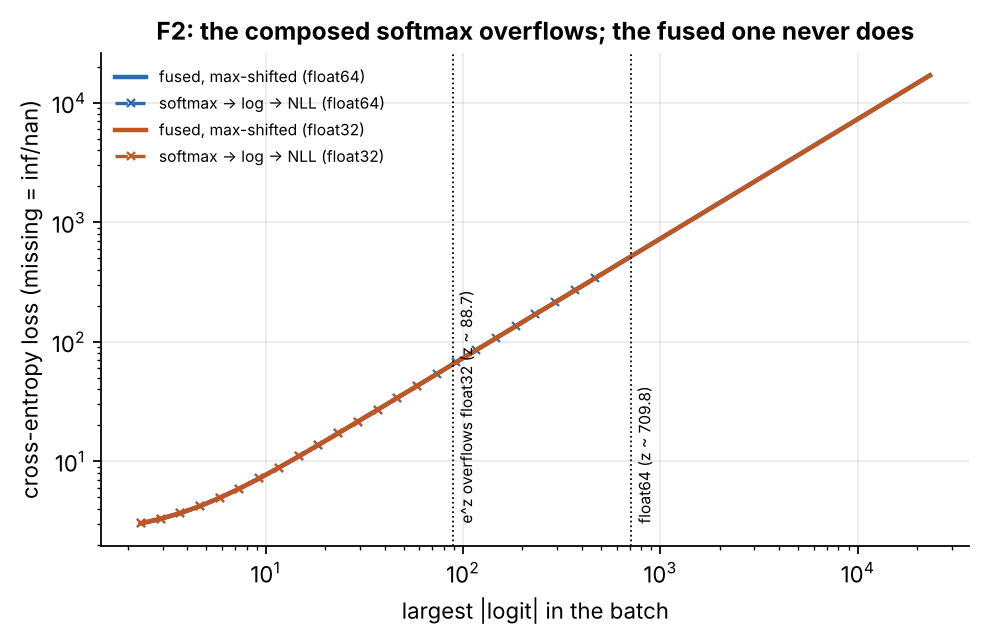

**F3. Dead ReLUs at high learning rate.** A 4 × 128 ReLU MLP (He init), plain SGD, 400 steps.
Fraction of units dead on 512 training images (worst layer), mean of 3 seeds [bootstrap CI]:

| Learning rate | Dead fraction at end |
|---|---|
| 0.01 | 0.05208 [0.03906, 0.0625] |
| 0.1 | 0.01562 [0.01562, 0.01562] |
| 0.3 | 0.06641 [0.05469, 0.07812] |
| 0.4 | 0.4844 [0.4844, 0.4844] |
| 0.5 | n/a |

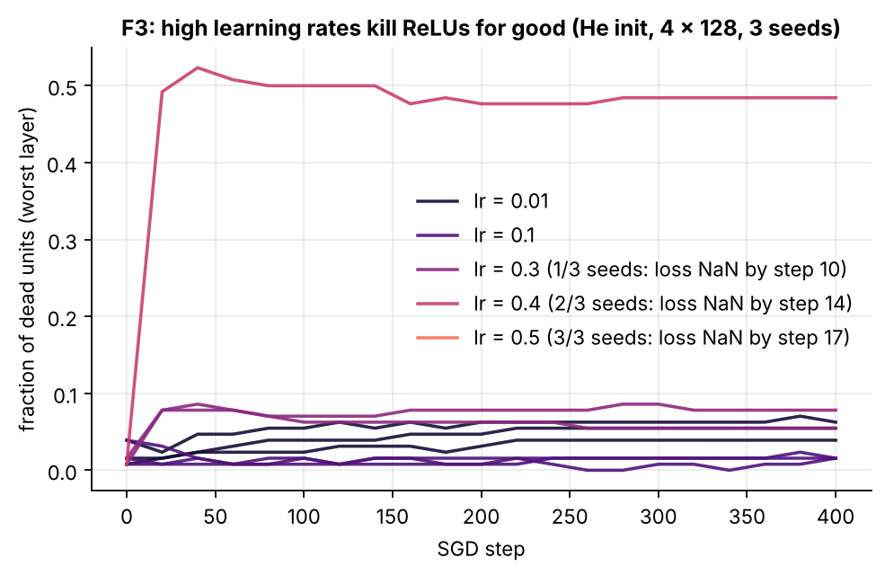

**F4. SGD divergence past the stable learning rate.** For least squares with Hessian H, gradient
descent converges iff lr < 2/λ_max (derivation D10.5). Here λ_max = 10.670, so the bound is
0.18744; the empirical edge found by bisection is 0.18759, a relative gap of
7.84e-4.

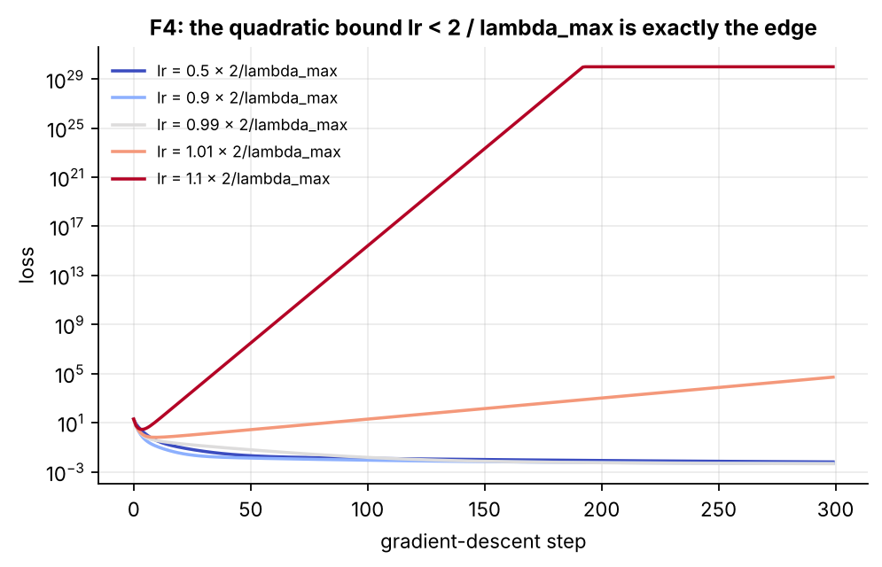

**F5. Finite differences at ReLU kinks and max-pool ties.** Within h of a kink or tie the
central difference measures an average of two one-sided slopes and the check fails, though the
code is correct. This is why gradcheck samples away from kinks (PRECISION.md, blind spots).

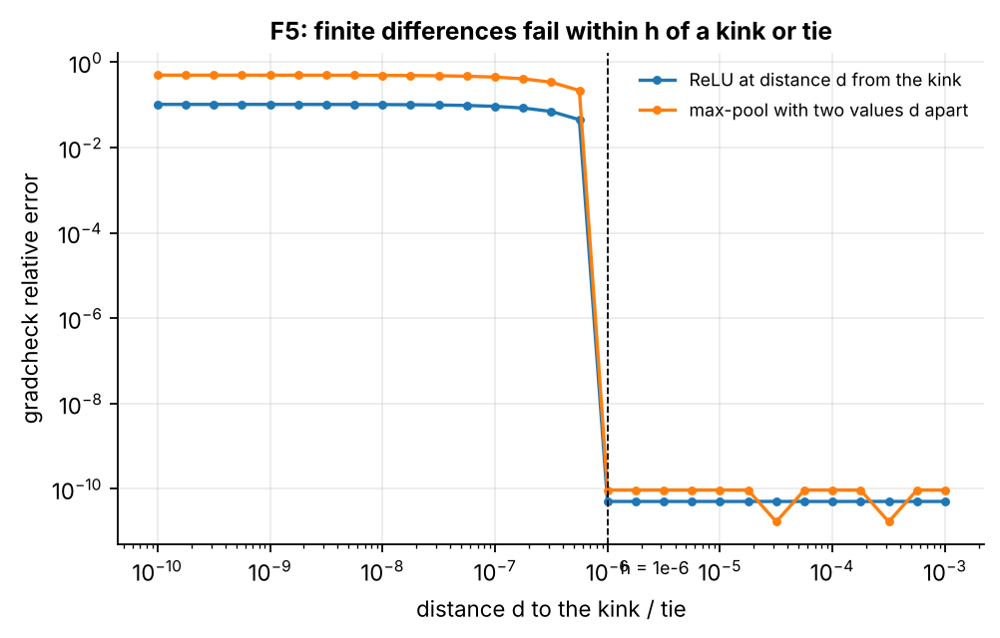

**F6. Every failing cell in E2**, with its diagnosed cause: section 4.

## 9. Cost and latency (E5)

One training step, single thread (`OMP_NUM_THREADS=1`, `torch.set_num_threads(1)`), median
[IQR] over 30 repeats. Hardware: Intel(R) Xeon(R) Processor @ 2.10GHz (4 cores), 15.7 GB RAM,
Linux 6.18.44-fc-v242, NumPy 2.5.3 with scipy-openblas 0.3.34.106.0, PyTorch 2.15.0.

| Workload | Nano ms | PyTorch ms | Slowdown | MFLOP/step | Nano GFLOP/s | PyTorch GFLOP/s | Nano peak MB |
|---|---|---|---|---|---|---|---|
| MLP 784-128-128-10, B=128, float64 | 2.28 [2.21, 2.38] | 1.62 [1.48, 1.79] | 1.4× | 90.6 | 39.79 | 55.83 | 2.6 |
| CNN 2xconv, B=64, float64 | 28.37 [27.78, 29.00] | 14.30 [12.03, 15.04] | 2.0× | 111.4 | 3.93 | 7.79 | 34.6 |
| MLP 784-128-128-10, B=128, float32 | 1.28 [1.22, 1.45] | 0.932 [0.869, 1.00] | 1.4× | 90.6 | 70.86 | 97.23 | 1.3 |
| CNN 2xconv, B=64, float32 | 17.71 [17.02, 18.30] | 7.25 [7.05, 7.50] | 2.4× | 111.4 | 6.29 | 15.37 | 17.9 |

im2col against the naive-loop convolution (forward + backward, conv 4->8, 3x3, 14x14, B=8):
111.98 ms vs 0.352 ms, a **318×** speedup from turning the
convolution into one matmul. Peak memory is Nano's traced NumPy allocation; PyTorch's allocator
is invisible to tracemalloc, so no PyTorch peak is claimed. The slowdown is measured and
published, not minimised (a PRD non-goal).

## 10. Reproduce everything

```bash
git clone <this repo> && cd NANO
make install
make repro          # data -> tests -> E1..E6 + failures -> results.json -> this report
```

Measured compute in this build: 6.2 CPU-hours summed over experiments (E2 dominates;
it runs on all cores, so wall time is roughly that divided by the core count). `make repro QUICK=1`
runs the whole pipeline at reduced size in minutes (its numbers are not the published ones).
Datasets are pinned by SHA-256, seeds are fixed in `experiments/seeds.json`, and versions of
Python, NumPy, BLAS and PyTorch are recorded in every results fragment.
